# EasyVisa

**A usability-focused redesign of the U.S. Government's Nonimmigrant Visa Application (DS-160) site.**

Original site: [ceac.state.gov/GenNIV/Default.aspx](https://ceac.state.gov/GenNIV/Default.aspx)

**Live prototype:** [maya2234.github.io/EasyVisa](https://maya2234.github.io/EasyVisa/) · **Source code:** [github.com/Maya2234/EasyVisa](https://github.com/Maya2234/EasyVisa) · **Demo video:** [ADD VIDEO LINK]

## Team

- Luke Brogee
- Maya Tomarchio
- Austin Heiss
- Kene Anosike
- Annalise Smith

## Project Overview

The DS-160 is the online form almost everyone applying for a temporary U.S. visa (tourism, study, work, exchange) has to complete. Its users are, by definition, a broad and international group: many are non-native English speakers, many will only ever use the site once, and the stakes of a mistake are high, since errors can delay or derail a visa interview.

Despite that, the entry point to the application (the Consular Electronic Application Center landing page) is dense, text-heavy and difficult to navigate. Important instructions are hidden behind unrelated-looking links, the page does not use the full browser width, and the controls needed to start or resume an application are surrounded by legal notices and small print.

We classify this as a **Category A redesign**: the current UI has significant usability and design-principle problems (learnability, layout, text hierarchy, link affordances and error handling) rather than a flawed underlying goal. Our aim with EasyVisa was to keep the same purpose of getting an applicant started on the DS-160 correctly while making the path there clear, readable and hard to get wrong.

## Research Methods

To ground the redesign in evidence rather than our own impressions, we used two methods from the project list:

1. **Observational study with a think-aloud protocol (method d)**, followed by a short post-task interview with each participant.
2. **Survey with Likert rating scales (method h)**, capturing self-reported impressions of the current site.

We also performed our own critique of the site's layout, instructions and navigation, which is summarized in *Usability Issues* below and which the study and survey were designed to test.

## Usability Issues (Initial Critique)

### Layout & Readability

- **Doesn't fill the screen.** The site says it's meant for Chrome, Edge, or Firefox only, but it doesn't use the full browser width; roughly half of a standard laptop screen is left as empty grey space.
- **Too much small text.** Pages are text-heavy, and nearly all of it is small, with little visual hierarchy separating what matters from fine print.
- **Important information is buried.** Key details about the application (write down your Application ID, save frequently, the 20-minute timeout) sit at the bottom of the page under "Additional Information," while the application button is near the middle, so users can easily miss them.

### Instructions & Help

- **Instructions are hard to find.** The instructions for filling out the form are behind an unrelated-looking link in a numbered list.
- **Instructions are hard to read.** Once opened, they're tightly spaced and in small text, so important information is easy to miss.
- **"Gather your documents" goes nowhere useful.** The link opens the general DS-160 FAQ page on travel.state.gov instead of opening or jumping to the relevant question about required documents.

### Navigation & Links

- **Unclear "OK" button.** The button for returning to the application page just says "OK", and the same label is used for several different links.
- **Links look like other text.** Links are shown only with italics and underlining, and the browser disclaimer ("This website is designed to be accessed using Chrome, Edge, or Firefox only") uses the same style, so it looks clickable.
- **No guidance on "Retrieve Application."** Nothing tells users when to use Retrieve Application rather than Start an Application. Some people will figure it out, but not everyone will.

## Research Findings

### Observational Study (Think-Aloud)

**Participants.** We ran three participants of college students with no prior DS-160 experience. Each session was run on a team member's laptop in Chrome and screen-recorded with the participant's think-aloud audio. Participants were told they were being recorded, that only our team would view the recordings, that all materials would be de-identified, and that they could stop at any time.

**Tasks.** Participants were asked to:

1. Find out what documents they would need before starting a DS-160.
2. Find the instructions for filling out the application.
3. Start a new application for a chosen location and reach the first page of the form (Personal Information 1).

**Results at a glance.**

| | Participant 1 | Participant 2 | Participant 3 |
|---|---|---|---|
| Session length | ~2.7 min | ~3.7 min | ~3.6 min |
| Reached Personal Information 1? | Yes | Yes, after restarting | Yes |
| CAPTCHA / required-field errors | 1 | 2 | 2 |
| Left the DS-160 site by mistake? | Only via "Gather your documents" link | Yes – ended on an error page, a 404 page, a consulate page and the separate visa *scheduling* portal | Only via FAQ link |
| Found document requirements? | Had to scan the general FAQ page | No | Had to scan the general FAQ page |

**Difficulty points observed**

*1. Every participant hit the CAPTCHA error at least once.* The "Enter the code as shown" field sits between the location dropdown and the photo notice and is easy to skip. All three participants pressed **Start an Application** with it empty or mistyped and got the red error box ("Please correct all areas in error… Enter the code as shown is required" / "The code entered does not match the code displayed"). Each failure generates a new code, so participants had to re-read a distorted image and try again. Participant 2 hit this twice in a row; Participant 3 also hit it twice.

*2. "Gather your documents" and "instructions" dump users into the general FAQ.* When Participant 1 and Participant 3 looked for the required documents or instructions, the link opened the travel.state.gov DS-160 FAQ page, a long accordion list ("Where can I find the DS-160?", "I am having problems accessing the DS-160"...). Participants had to scroll and open questions one by one to find the one about documents, and then navigate back to the application page.

*3. A participant got completely lost outside the application.* After the CAPTCHA errors, Participant 2 ended up on an "Error: There was an error processing the request" page with no way back except the browser. From there they went to a travel.state.gov 404 page, then the general U.S. Visas page, then the U.S. Consulate Sydney page, then **usvisascheduling.com** (a Cloudflare bot check), and finally the *Apply for a U.S. Visa* login portal, which is a different system for scheduling interviews. Only after this detour did they return to ceac.state.gov and restart with a new location. This shows how easily the DS-160 can be confused with the other visa sites it links to.

*4. The location dropdown is long, and its search shortcut is invisible.* The "Select a location where you will be applying for this visa" dropdown is a single alphabetical list of every embassy and consulate in "COUNTRY, CITY" format. Participant 2 scrolled through dozens of entries (Lithuania… Mexico… Uruguay) before choosing. Participant 1 found they could type "GER" to jump to Germany and called it the one thing they liked, so typing to search helps, but only users who already know it exists.

*5. Reading the landing page takes a long time.* Participant 3 spent well over a minute on the landing page without clicking anything before making a selection. In the interview they explained that they had read the whole homepage, so the page's volume of text costs time even for users who do read it.

*6. The page shifts and hides controls.* Choosing a location inserts a new photo notice above the Start/Retrieve buttons, pushing them down the page. Combined with the error box appearing after a failed CAPTCHA, the layout moves several times while the user is trying to act.

*7. A dense legal page blocks the start.* After clicking Start, every participant landed on the *Computer Fraud and Abuse Act Notices* page, a wall of small legal text with the required "I AGREE" checkbox at the very bottom, before reaching the Application ID page and the security question.

*8. Language settings are confusing.* During Participant 1's session the Tooltip Language was changed to German (Deutsch), translating the help banner while the rest of the page stayed in English. The "Select Tooltip Language" control in the header looks like a site language selector but only affects hover tooltips.

### Post-Task Interviews

After the tasks, we asked each participant open follow-up questions about the site's look, how much they read, what confused them and anything they liked. The recordings were transcribed and are summarized below.

- **Participant 1:** Disliked the color scheme: red and maroon draw the eye to unimportant things like the translation banner and "Welcome." Found the CAPTCHA on the same page confusing and wished it were a separate pop-up. Felt there was no clear path, and wanted the "before you start" steps to be separate, sequential pages instead of everything on one page; also wanted the site to fill the screen on a laptop. Read almost none of the text, only Get Started and the start/retrieve panel, because "it's in paragraph form, and I'm very bullet point slash like visual person." Said the dark text on dark blue in the Start box was hard to see, and treated it as an optional guideline. Copied the Application ID without knowing what it was for, and set a security question without knowing why. The one thing they liked was the location dropdown, where typing "GER" jumped straight to Germany.
- **Participant 2:** Found the site poorly organized: "my eyes don't know where to jump to." Said it sent them to a random site and the Start button wasn't working, which matches the error page and detour in their session. Was so overwhelmed they skipped all reading and went straight to wherever it asked them to type. Main complaints were that it's not easy to navigate and has too much information. On the positive side, once they reached the actual form (surname, given name), it felt self-explanatory. Didn't know what the Computer Fraud and Abuse Act had to do with a visa, and never saw the instruction to record their Application ID; their eyes went straight to the security question.
- **Participant 3:** The most positive participant, and the only one who read the landing page in full. Found it official-looking and not overwhelming, and liked the time estimate, the concise hyperlinked "before you start" list, the help notes and the progress indicators inside the form. Still flagged several problems: the CAPTCHA felt outdated; the "select a location" wording could confuse non-native English speakers; and the note to write down the Application ID, placed under "Additional Information," read as optional ("it's just like, oh, by the way"). Suggested that truly important notes be highlighted or shown in a pop-up before the application starts. Liked having the legal notice and security question together because it signaled that the content mattered.

**Common themes**

- **Most people don't read the text.** Two of three participants skipped nearly everything and jumped to the first thing that looked like an action. Long paragraphs and low-contrast text were treated as optional.
- **Critical information doesn't look critical.** None of the three understood why the Application ID mattered: Participant 1 copied it without knowing why, Participant 2 never saw it, and Participant 3 saw it but took it as an aside because it sat under "Additional Information."
- **There's no clear path.** Participants wanted a step-by-step flow rather than everything on one page, and the CAPTCHA confused or annoyed all three.
- **Not everyone is overwhelmed.** Participant 3, a careful reader, found the amount of text manageable. The redesign should simplify the page without removing information careful readers rely on.

### Survey Results

We collected **10 responses** to our 14-item "Visa Application Ease of Use Survey" on Google Forms, asking people who had used or tried the DS-160 site to rate each statement on a 5-point scale (1 Strongly disagree, 2 Disagree, 3 Neutral, 4 Agree, 5 Strongly agree). Some statements were worded positively and some negatively, so a good experience shows up as high scores on positive items and low scores on negative items.

| Statement | Mean | Agree (4–5) | Disagree (1–2) |
|---|---|---|---|
| I was overwhelmed with the amount of information on the screen | 4.3 | 9 / 10 | 1 / 10 |
| I found the product unnecessarily complex | 4.1 | 8 / 10 | 1 / 10 |
| I was very frustrated while applying | 4.0 | 7 / 10 | 2 / 10 |
| I made multiple mistakes while applying | 3.8 | 6 / 10 | 2 / 10 |
| I found the text to be difficult to read | 3.3 | 5 / 10 | 3 / 10 |
| I struggled to find the instructions to fill out an application | 3.0 | 3 / 10 | 4 / 10 |
| I was able to accomplish everything I set out to do on this website | 2.9 | 4 / 10 | 3 / 10 |
| I was able to read all text on the page easily | 2.4 | 4 / 10 | 6 / 10 |
| I found completing my objectives to be accessible and straightforward | 2.4 | 3 / 10 | 6 / 10 |
| I knew how to find the instructions to fill out an application right away | 2.3 | 1 / 10 | 7 / 10 |
| I easily followed all the steps to apply with no mistakes | 2.1 | 2 / 10 | 6 / 10 |
| I found it intuitive to apply for a visa | 1.9 | 1 / 10 | 8 / 10 |
| I think that I would use this product frequently | 1.7 | 1 / 10 | 8 / 10 |
| I found the site aesthetically pleasing | 1.5 | 1 / 10 | 9 / 10 |

**What the survey tells us**

- **Information overload is the strongest signal.** 9 of 10 respondents felt overwhelmed by the amount of information on screen (mean 4.3), and 8 of 10 found the site unnecessarily complex. This directly supports simplifying the landing page.
- **The site is not intuitive and causes errors.** Only 1 respondent found applying intuitive (mean 1.9), 6 of 10 reported making multiple mistakes, and only 2 felt they followed every step without mistakes. This lines up with the CAPTCHA and navigation errors we saw in the observational study.
- **Instructions are not discoverable.** Only 1 respondent knew right away where to find the instructions (7 of 10 disagreed). The related item "I struggled to find the instructions" was more mixed (mean 3.0), suggesting people *could* eventually find them, but not quickly or confidently.
- **Readability is a problem for most, but not all.** 6 of 10 could not read all the text easily and half found the text difficult to read. Responses here were more split than on overload, so text size is one problem among several rather than the main one.
- **Users can usually get there, but it costs them.** Ability to accomplish their goals was middling (mean 2.9), while frustration was high (mean 4.0, median 5). People generally complete the task, but the experience is stressful.
- **Visual design is almost universally disliked.** 9 of 10 did not find the site aesthetically pleasing (mean 1.5), the most one-sided result in the survey.

*Note:* the sample is small (n = 10) and not random, so we treat these results as directional evidence that supports and prioritizes the issues found in the observational study rather than as precise measurements.

## Design Goals

Combining the critique, the observational study and the survey, we focused the redesign on these goals:

| Goal | Evidence |
|---|---|
| **Reduce what's on the landing page to one clear decision: start or resume.** | 9/10 overwhelmed; 8/10 found it unnecessarily complex; Participant 3's long hesitation |
| **Explain *Start* vs *Retrieve* in plain language** so users know which to choose. | No guidance on Retrieve Application in current UI; participants unsure where to begin |
| **Bring the "before you start" information forward** (documents needed, save your Application ID, 20-minute timeout) instead of burying it at the bottom. | Key info sits below the fold; participants left the site to find document requirements; none of the 3 understood why the Application ID mattered |
| **Link help directly to the relevant answer,** not the general FAQ. | Participants 1 and 3 had to scan the full FAQ to find documents |
| **Make the location picker visibly searchable.** | Participant 2 scrolled through dozens of entries; Participant 1 liked typing to jump to a country but found it by accident |
| **Make required fields and errors obvious before submission,** and keep the layout stable. | All 3 participants triggered the CAPTCHA error; buttons moved as notices appeared |
| **Keep users inside the DS-160 flow** and make clear which site they're on. | Participant 2 ended up on an error page, a 404 and the separate scheduling portal |
| **Use the full screen, larger text and a clear visual hierarchy,** with links that look like links and buttons with descriptive labels. | 6/10 couldn't read all text easily; 9/10 found the site unattractive; italic-underline links and generic "OK" buttons |

## Sketches, Wireframes & Feedback

We did our initial planning for the redesign in Figma ([view the Figma file](https://www.figma.com/design/uFSguu9zazmVgmcBmS8OFR/UI-Project-2-Easy-Visa)), working at desktop width (about 1440 px) so the layout uses the whole screen instead of the original's narrow column. Every screen shares one header and footer. The header has a page-level language selector and two persistent links, **Before you begin** and **Help & FAQs**. The footer gathers the outside links (Travel.State.Gov, U.S. embassies & consulates) and labels the project as an independent design concept, not an official government website.

The wireframes cover the path from the landing page to the start of the form. We also reordered that path: the original site asks for location and the CAPTCHA first and shows the legal notice afterwards, while EasyVisa shows the terms first and then asks for location and verification together.

### 1. Landing page

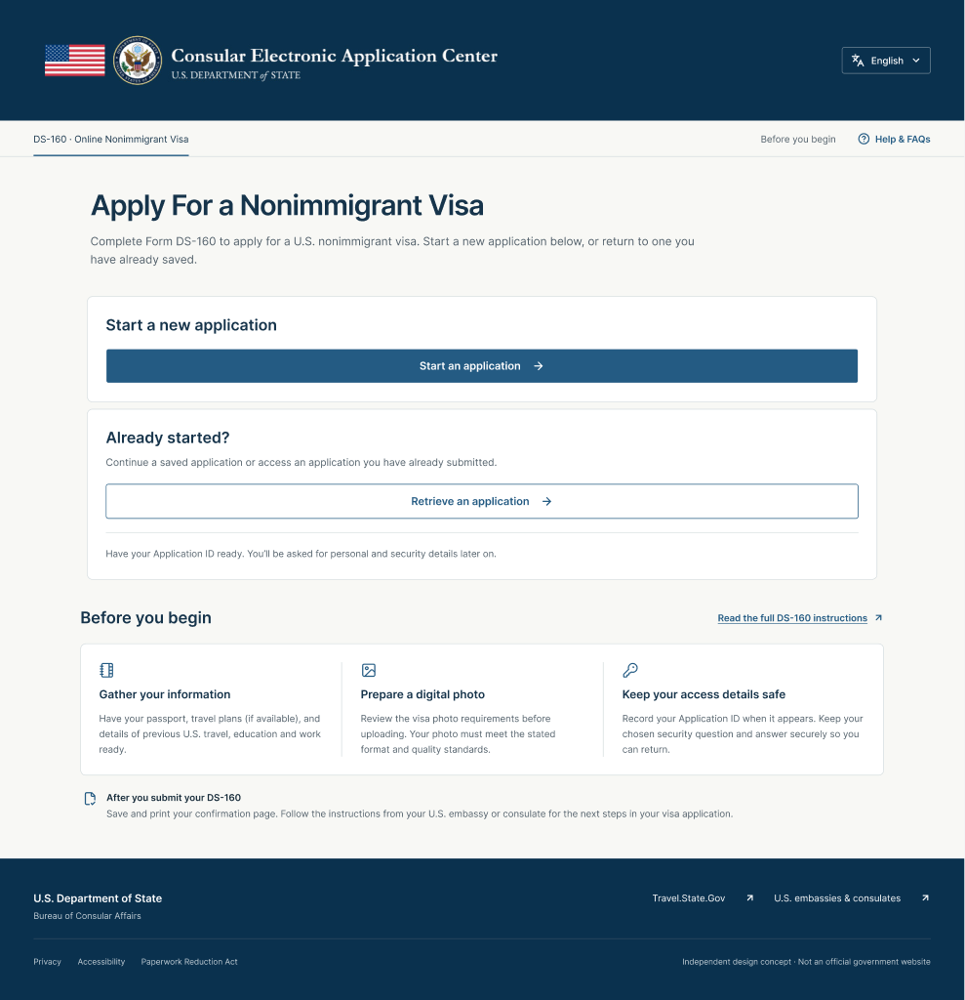

The landing page is reduced to one decision: **Start a new application** (a solid primary button) or **Already started?** (an outlined Retrieve button). The Retrieve card explains in one line when to use it ("Continue a saved application or access an application you have already submitted") and reminds users to have their Application ID ready. This answers the critique that nothing explained Retrieve Application, and Participant 3's long hesitation before the first click.

Below the two choices, a **Before you begin** section replaces the old paragraphs with three short, icon-led cards: *Gather your information*, *Prepare a digital photo*, and *Keep your access details safe*. The third card says up front that the Application ID and security answer matter, which none of our participants understood on the original site. A single, clearly styled **Read the full DS-160 instructions** link replaces the hard-to-find instructions link. This layout follows Participant 1's request for short, visual points instead of paragraphs, and the survey's strongest finding (9 of 10 respondents felt overwhelmed).

### 2. Review the terms

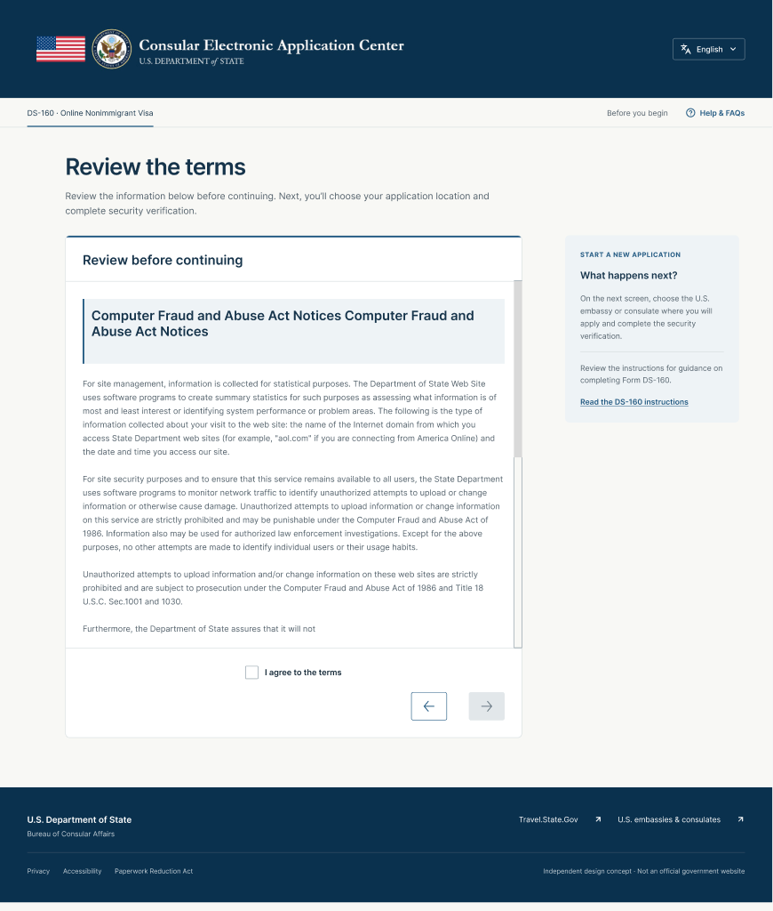

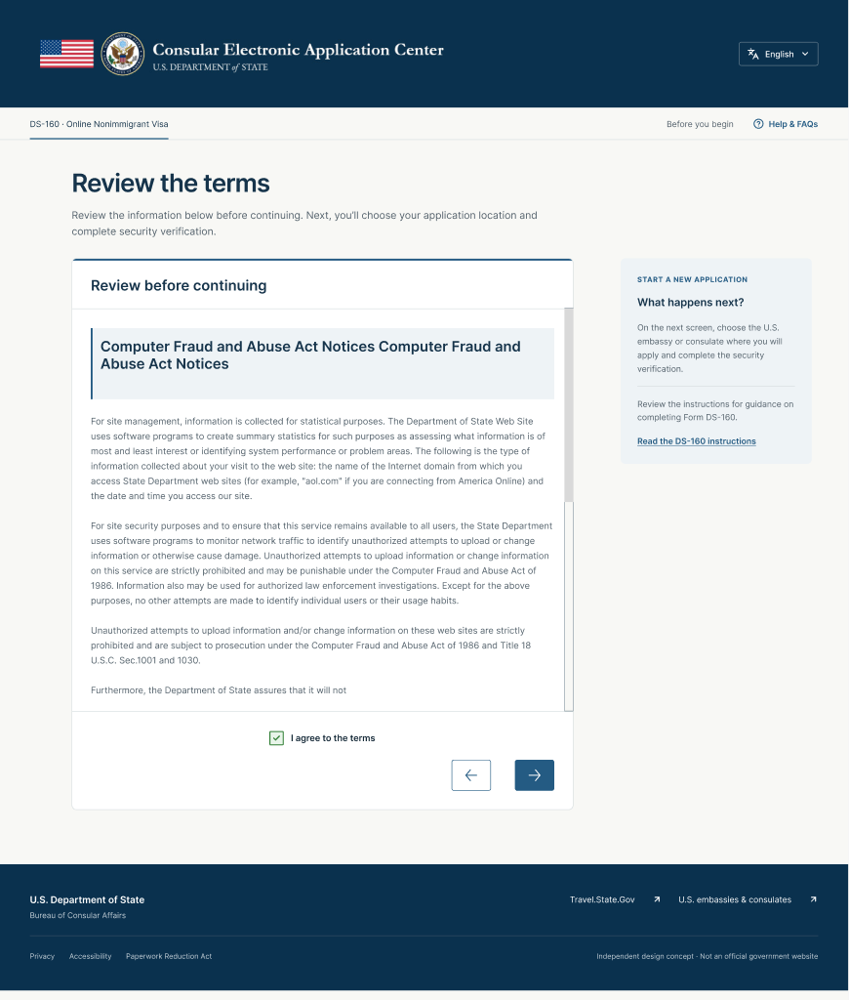

The Computer Fraud and Abuse Act notice now sits in its own scrollable panel under a plain heading, **Review before continuing**, so the legal text no longer pushes the agreement checkbox to the bottom of a long page. The **I agree to the terms** checkbox sits directly below the panel, and the Next arrow stays greyed out until it is checked (second image), so users can't skip the step or be left wondering why nothing happened. A side panel titled **What happens next?** tells users the next screen will ask for their embassy or consulate and a security check, and links to the instructions. This responds to Participant 2's confusion about why the notice was there at all.

### 3. Start a new application

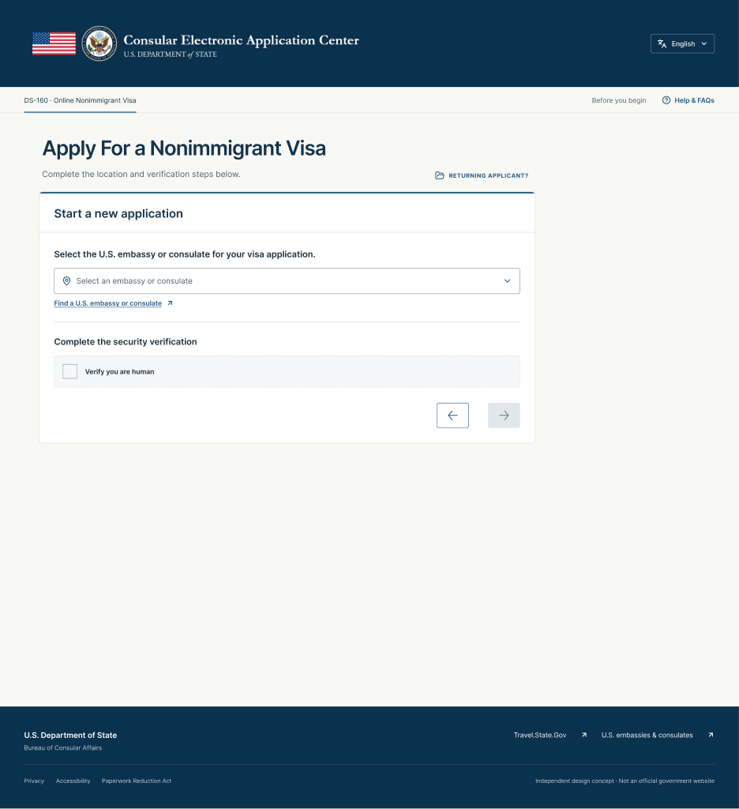

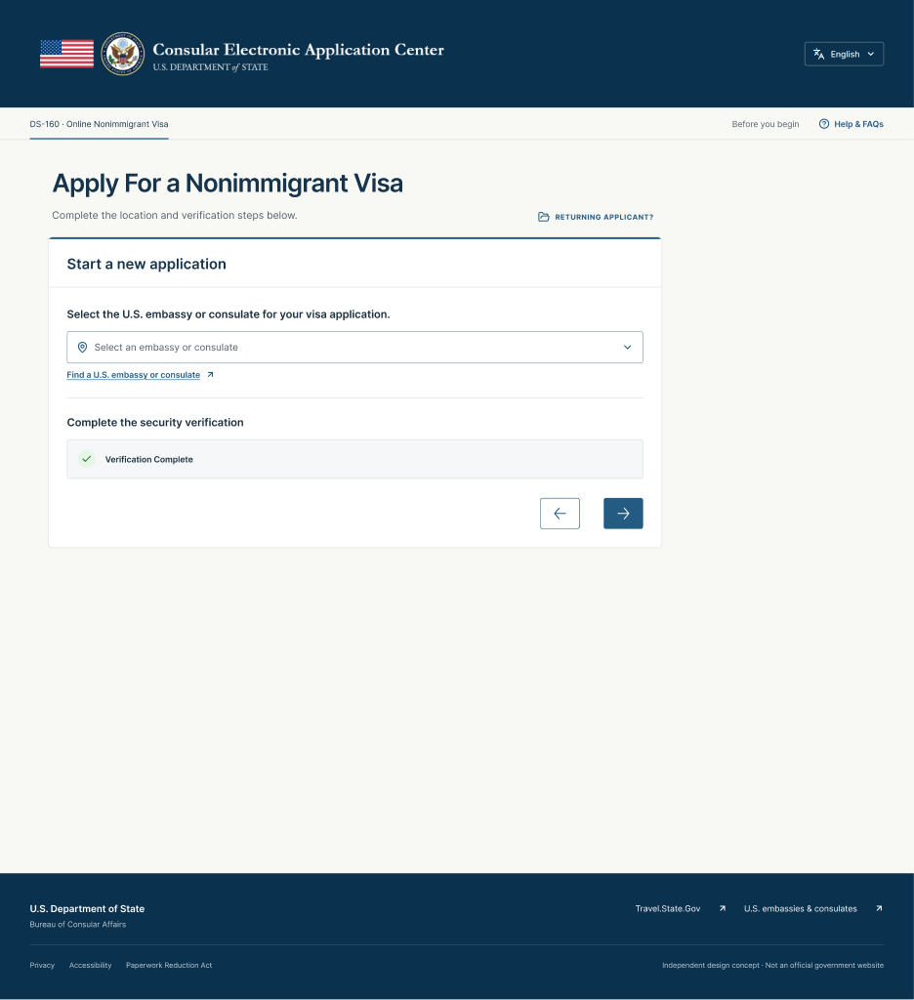

Location and verification are now two clearly numbered steps in one card:

- **Location:** the question is reworded in plain language ("Select the U.S. embassy or consulate for your visa application"), which addresses Participant 3's concern about non-native English speakers. A **Find a U.S. embassy or consulate** link sits right under the field for users who don't know which one to choose.
- **Verification:** the distorted-text CAPTCHA, which every study participant failed at least once, is replaced by a single **Verify you are human** checkbox. Once it's done, the box changes to *Verification Complete* with a check mark (second image).
- **Navigation:** Back and Next buttons replace the original's separate Start and Retrieve buttons, and Next only activates when both steps are complete. A **Returning applicant?** link keeps the way back to Retrieve visible without competing with the main task.

Because nothing is inserted above the buttons mid-task (as the original's photo notice and error box were), the layout stays stable while the user works.

## The EasyVisa Redesign

### Changes in the Redesign

Each change below responds to a specific finding from our critique, observational study, interviews or survey.

- **One clear decision on the landing page.** The landing page now offers only two paths: **Start a new application** or **Already started?** → **Retrieve an application**. The Retrieve card says exactly when to use it and lists what you'll need (Application ID, first five letters of your surname, year of birth, security answer). *Addresses:* no guidance on Retrieve Application; 9/10 survey respondents overwhelmed; Participant 3's long hesitation.
- **Short "Before you begin" checklist instead of paragraphs.** Three icon-led items (*Gather your information*, *Prepare a digital photo*, *Keep your access details safe*) replace the dense Welcome, Notes and Additional Information text. *Addresses:* Participant 1 reading none of the paragraphs ("I'm very bullet point slash like visual person").
- **Document requirements one click away.** An ⓘ button next to *Gather your information* opens a **What to have ready** pop-up listing the required documents, including extra items for students, exchange visitors and temporary workers. The pop-up closes with ✕, Escape or a click outside. *Addresses:* "Gather your documents" sending users to the general FAQ (Participants 1 and 3).
- **Direct, clearly styled links.** The photo tip links straight to the visa photo requirements, the instructions link is labelled **Read the full DS-160 instructions**, and outside links carry an ↗ arrow so it's obvious they open another site. *Addresses:* links that looked like plain text; users getting lost on other State Department sites (Participant 2).
- **Terms before the application, with a gated Next button.** The Computer Fraud and Abuse Act notice sits in its own scrollable card with the **I agree to the terms** checkbox directly beneath it. The Next arrow stays disabled until the box is ticked, and a **What happens next?** panel explains the next step. *Addresses:* the legal page burying the checkbox; Participant 2 not knowing why the notice was there.
- **Plain-language location step.** The location question is reworded as "Select your visa interview/processing location (U.S. Embassy or Consulate)", with a **Find a U.S. embassy or consulate** link underneath. *Addresses:* Participant 3's concern about wording for non-native English speakers.
- **One-click verification instead of a distorted-text CAPTCHA.** A **Verify you are human** box turns into *Verification Complete* when clicked, and Next only unlocks once a location is chosen and verification is done. *Addresses:* every participant failing the original CAPTCHA at least once.
- **A safety net for returning applicants.** A **Returning applicant?** link on the start page opens an inline message ("Leave this new application?") with **Go to returning applicant** and **Stay on this page**, so nobody loses their place by accident.
- **A forgiving Retrieve page.** The Application ID box upper-cases as you type, removes spaces and dashes, shows a 10-character counter and searches automatically when the ID is complete. Not-found errors say exactly what to check and offer **Start a new application instead**, and a side panel answers "Can't find your Application ID?". *Addresses:* the error page and dead end Participant 2 hit.
- **The Application ID you can't miss.** On the form page, the Application ID sits in its own highlighted box with the instruction "Write this down. You'll need it to come back to your application." *Addresses:* none of the three participants understanding why the Application ID mattered.
- **Autosave with visible status.** The form shows *Changes save automatically*, then *Saving…* and *Saved [time]* as you type, plus a manual Save button. *Addresses:* the original's 20-minute timeout warning buried at the bottom of the landing page.
- **Review before submitting.** A **Review and submit** page summarizes every answer with an **Edit** button per section, and **Submit application** stays disabled until the applicant ticks the certification box.
- **A clear confirmation and next steps.** After submitting, applicants see their confirmation number, a numbered **What happens next** list (print the confirmation, pay the fee, schedule the interview) and a **Print confirmation** button.
- **Real language switching.** The header language menu translates the entire site, not just tooltips. English and Spanish are complete; Chinese, Hindi, Arabic, Portuguese, French, Vietnamese and Korean are listed but greyed out as planned. *Addresses:* the original's tooltip-only translation (finding 8).
- **Full-width, readable layout.** Content uses the whole screen with larger type, a consistent header (with **Help & FAQs** always visible) and a consistent footer. On smaller laptop screens the whole page scales down proportionally, and phones and tablets get stacked layouts. *Addresses:* the half-empty screen and small text; 6/10 respondents unable to read all the text easily; 9/10 finding the original unattractive.

### Interface Walkthrough

The prototype is live at [maya2234.github.io/EasyVisa](https://maya2234.github.io/EasyVisa/). It is fully clickable from start to confirmation. Sample answers are pre-filled so the flow can be tested quickly, and nothing typed is stored or sent anywhere.

**1. Landing page**

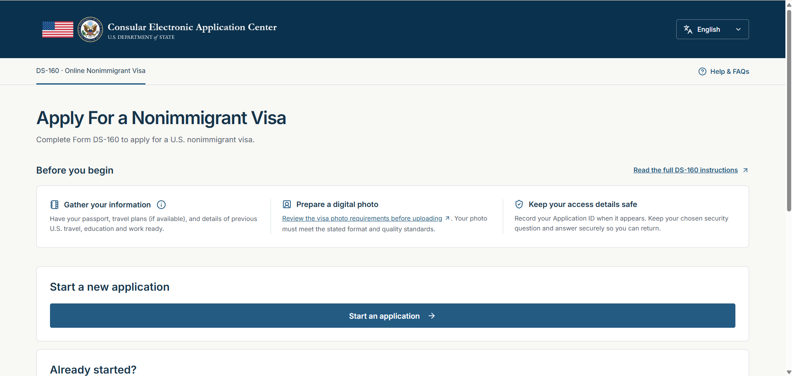
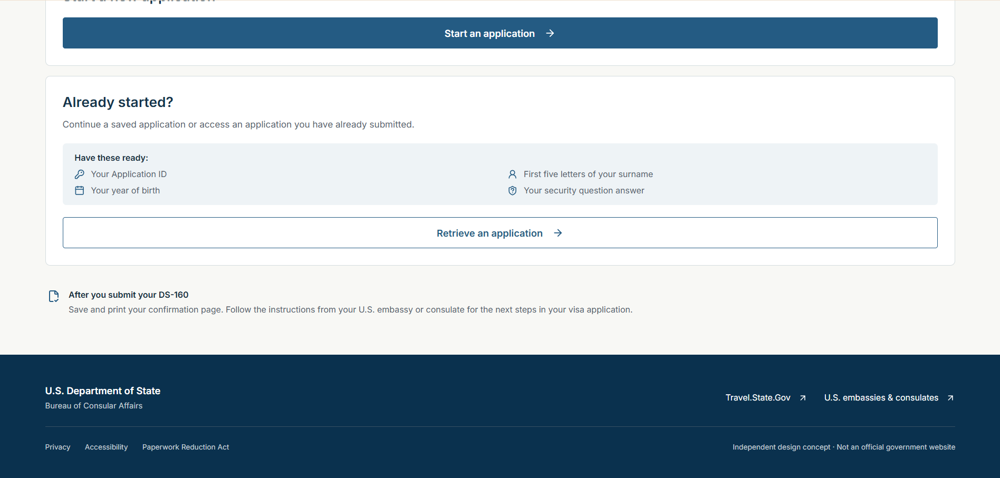

The page opens with the title and a one-line description, then the **Before you begin** checklist. Below it are two cards: **Start a new application** with a solid **Start an application** button, and **Already started?** with an outlined **Retrieve an application** button and a short "Have these ready" list. A note at the bottom explains what to do after submitting.

**2. "What to have ready" pop-up**

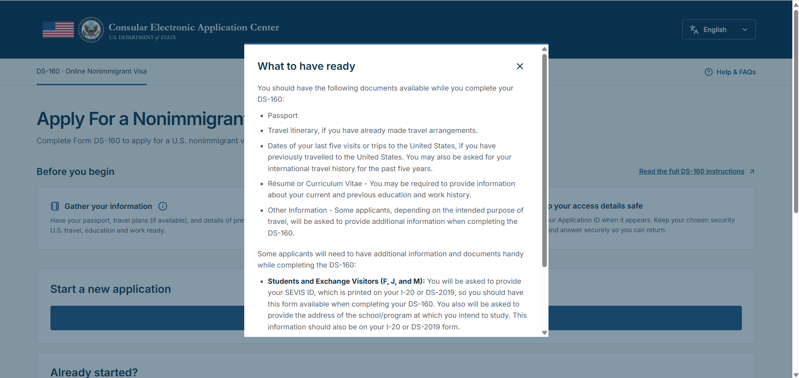

Clicking the ⓘ next to *Gather your information* opens a pop-up listing the documents every applicant needs, plus extra requirements for students and exchange visitors, petition-based workers and other temporary workers. Close it with ✕, the Escape key, or by clicking outside it.

**3. Review the terms**

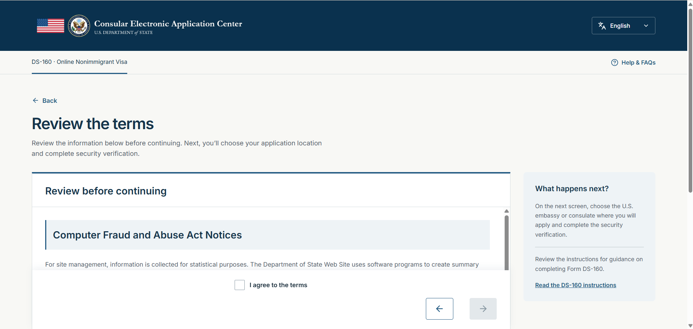
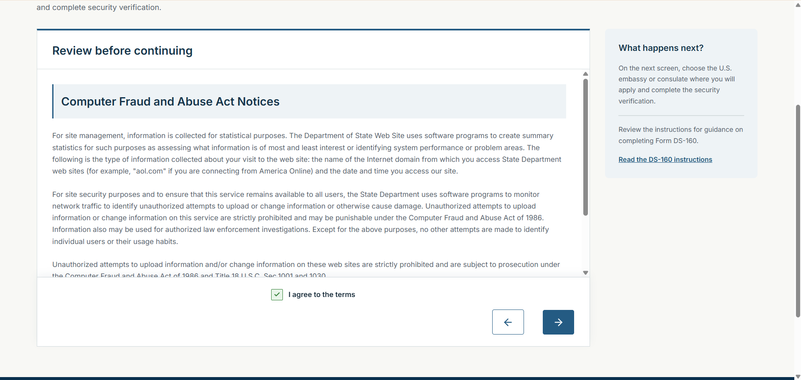

The legal notice scrolls inside its own card. Ticking **I agree to the terms** unlocks the → button; ← and the **Back** link return to the landing page. The **What happens next?** panel on the right explains the next screen and links to the DS-160 instructions.

**4. Start a new application**

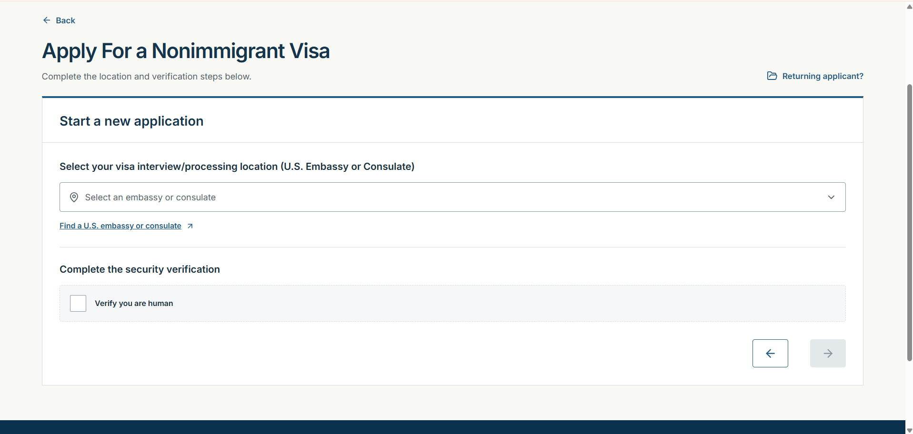
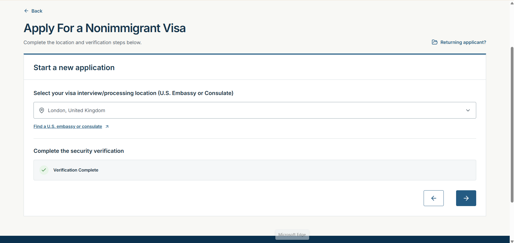

Choose an embassy or consulate from the dropdown (the prototype lists eight sample locations), then click **Verify you are human**. The → button activates once both are done and opens the form with a newly generated Application ID. **Returning applicant?** shows an inline message offering to switch to the Retrieve page or stay.

**5. Retrieve an application**

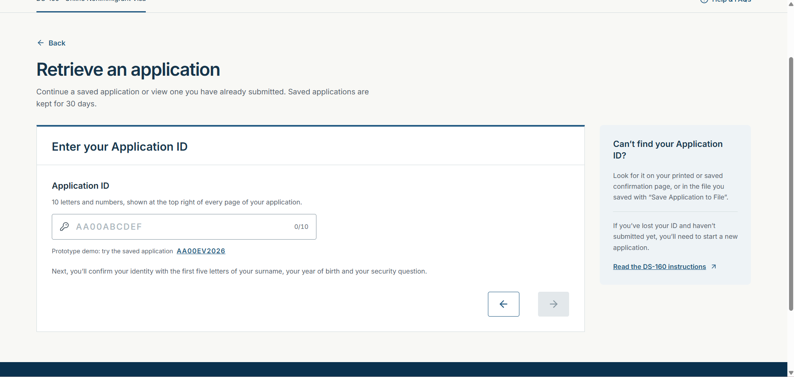
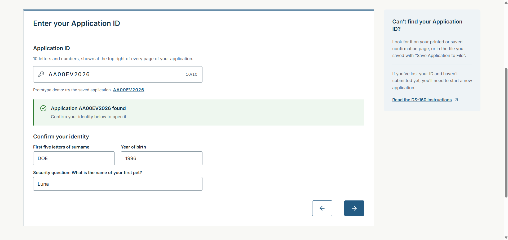

Type a 10-character Application ID. The box formats it as you type, counts characters and searches automatically. For the demo, click the sample ID **AA00EV2026** shown under the box. Once the application is found, a green confirmation appears with three identity fields (first five letters of surname, year of birth, security answer), pre-filled for the demo. → then opens the saved application. Any other ID shows a clear "We couldn't find application …" message with a link to start a new application instead.

**6. Your application**

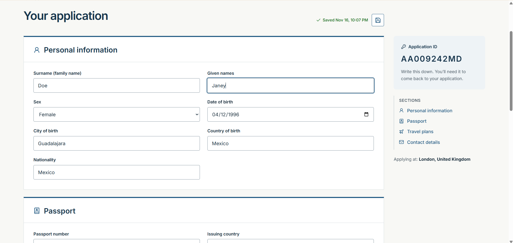

The form is split into four cards: **Personal information**, **Passport**, **Travel plans** and **Contact details**. The side panel shows the Application ID with a reminder to write it down, a **Sections** list that jumps to each card, and the chosen embassy under **Applying at**. Edits trigger the autosave indicator next to the Save button. **Continue to review** moves on.

**7. Review and submit**

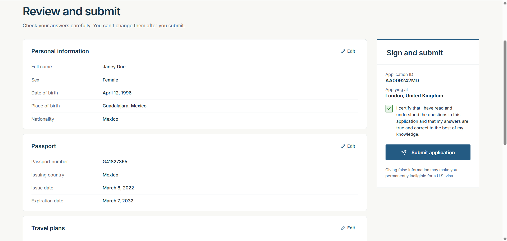

Every answer is listed by section, each with an **Edit** button that returns to the form. The **Sign and submit** card repeats the Application ID and location, and **Submit application** activates only after the certification box is ticked.

**8. Confirmation**

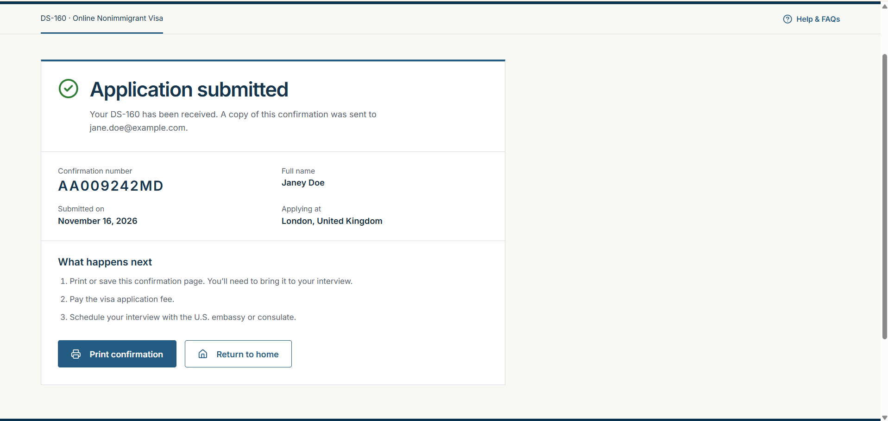

The confirmation shows the confirmation number, applicant name, submission date and location, followed by the three next steps. **Print confirmation** opens the browser's print dialog, and **Return to home** goes back to the start.

**Language switching**

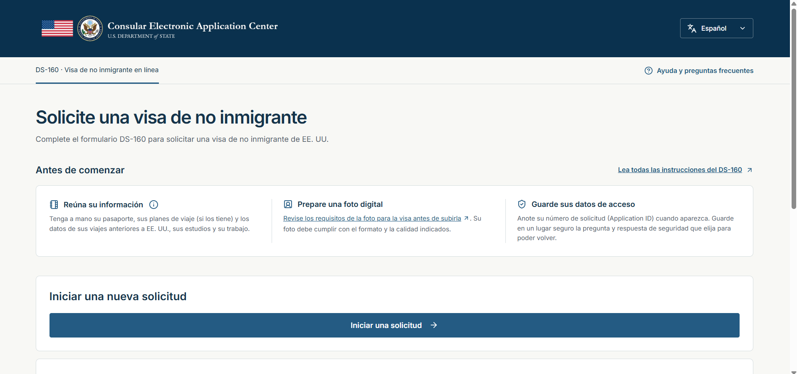

Choosing **Español** in the header menu instantly translates every screen, including the pop-up, alerts and form labels.

## Implementation

EasyVisa is a front-end-only single-page app built with **Svelte 5** and **Vite 6**, with no backend or database. Data lives in memory for the length of the visit, and refreshing the page starts over at the landing page.

- **Design tools:** Figma for the wireframes and layout.
- **Framework and build:** Svelte 5 (using runes such as `$state`, `$derived` and `$props`) with Vite 6 and `@sveltejs/vite-plugin-svelte`. We used plain Svelte rather than SvelteKit, because the prototype is one page that swaps screens.
- **Libraries:** [Lucide](https://lucide.dev) icons via `@lucide/svelte`. All styling is hand-written CSS: shared styles in `src/app.css`, and scoped styles inside each component.
- **Code structure** (`src/`):
  - `main.js` mounts the app and scales the page to fit smaller laptop screens, keeping the 1440 × 800 proportions the design was built for.
  - `App.svelte` holds a single `page` state and shows one screen at a time, using a `goTo()` function passed to each page instead of a router.
  - `Header.svelte` and `Footer.svelte` are shared on every screen. The header contains the language menu and the Help & FAQs link.
  - There is one component per screen: `HomePage`, `TermsPage`, `StartApplicationPage`, `RetrieveApplicationPage`, `ApplicationFormPage` and `SubmitPage`.
  - `application.svelte.js` is the shared application state (ID, embassy, answers, save and submit times). It generates realistic Application IDs (`AA00` plus six characters) and pre-fills sample answers so the flow can be clicked through.
  - `i18n.svelte.js` stores every piece of on-screen text in English and Spanish. Components call `t('key')`, and changing the language updates every page immediately.
- **Hosting:** GitHub Pages at [maya2234.github.io/EasyVisa](https://maya2234.github.io/EasyVisa/). A GitHub Actions workflow (`.github/workflows/deploy.yml`) builds the site and publishes it on every push to `main`, and Vite's `base: '/EasyVisa/'` setting makes the paths work under the repository's sub-folder.
- **Source code:** [github.com/Maya2234/EasyVisa](https://github.com/Maya2234/EasyVisa)
- **Run locally:** `npm install`, then `npm run dev`.

## Use of AI

AI was used to assist in parts of the wireframe construction and to help us become familiar with Figma itself. AI was also used to assist in converting the Figma wireframe to code.

## Future Work

No project is ever fully done. Based on our research and what we built, these are the next steps we would take:

- **Test the redesign with users.** Run the same three tasks and the same survey with new participants on EasyVisa, and compare errors, time on task and self-reported scores against the original site.
- **Build out the full DS-160.** Our form covers four core sections as a demonstration. The real DS-160 has many more (family, work and education history, security questions), and they would need the same card layout, autosave and review treatment.
- **A searchable location picker.** The prototype lists eight sample embassies in a standard dropdown. The real list has hundreds, so the next step is a type-to-search field with country and city matching, building on Participant 1's one positive comment about the original.
- **More languages.** English and Spanish are complete. The other seven languages in the menu are placeholders, and real translations, including right-to-left layout for Arabic, are needed.
- **Real verification and saving.** The "Verify you are human" box and the Application ID lookup are simulated. A working version would connect to a real bot check and a backend that stores applications for the 30-day window.
- **Validation and accessibility.** Add inline error messages on form fields, and test the site with screen readers and keyboard-only navigation.
- **Clearer connections to related sites.** Better signposting between the DS-160, travel.state.gov and the separate interview-scheduling portal, so users always know which site they're on and what it's for.

## Demo Video

[EMBED OR LINK 2–3 MINUTE DEMO VIDEO — include project name, team members, project components and a walkthrough of the interface]

